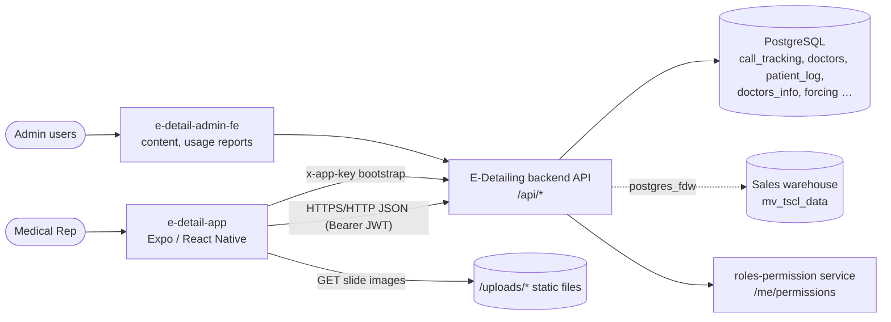
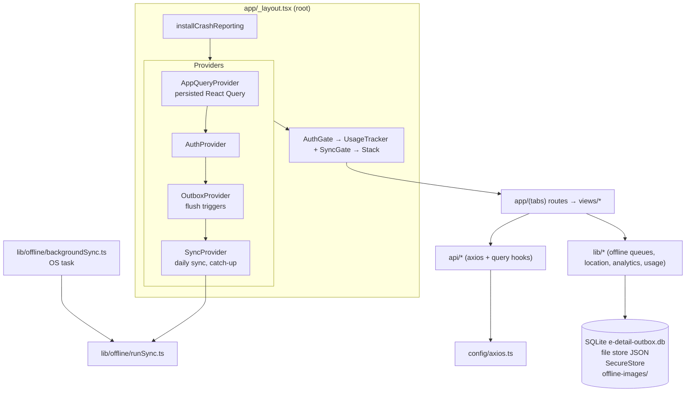

# System Architecture

The architecture as built, at commit `e4f6eda`. Decisions behind it are in
[decisions/](decisions/); the stack and code layout are in
[technical-standards.md](../standards/technical-standards.md).

## 1. Context

| External system | Used for | Spec |
|---|---|---|
| E-Detailing backend (`EXPO_PUBLIC_API_BASE_URL`, port 3017) | Auth, doctors, calls, content, sync, patients, profiles, sales, usage | [openapi.json](../api/openapi.json) |
| Roles-permission service (via `/me/permissions`) | Dashboard whitelisting | [permissions.md](../domains/permissions.md) |
| PMDC registry (via backend) | Doctor identity lookup | [doctor-info.md](../domains/doctor-info.md) |
| Sales warehouse (via backend, postgres_fdw) | Sales analytics | [analytics.md](../domains/analytics.md) |
| Admin console (`e-detail-admin-fe`) | Content management; usage and crash reports | [content.md](../domains/content.md), [telemetry.md](../domains/telemetry.md) |
| Expo EAS | Builds (`sandbox`, `production` profiles) | [technical-standards.md](../standards/technical-standards.md) |
| Device OS | GPS, camera and photos, secure storage, background tasks, battery | Domain specs |

## 2. App components

| Component | Responsibility | Key files |
|---|---|---|
| Root layout | Crash capture, fonts, provider tree, auth redirect, call screen locked against back | `app/_layout.tsx` |
| AuthProvider | Sign-in (online and offline), session, password change, permission loading | `providers/AuthProvider.tsx` |
| QueryProvider | React Query client, NetInfo-driven online state, cache persistence | `providers/QueryProvider.tsx`, `lib/offline/persister.ts` |
| OutboxProvider | Initialises the three queues and flushes them on start, reconnect, token and manual triggers | `providers/OutboxProvider.tsx` |
| SyncProvider / SyncGate | Daily sync orchestration; first-run gate and status banner | `providers/SyncProvider.tsx`, `components/ui/SyncGate.tsx` |
| Tabs layout | Home, e-Detailing, Analytics and Settings tabs; hidden routes for card screens | `app/(tabs)/_layout.tsx` |
| HTTP client | Base URL, headers, bearer token, 401 policy | `config/axios.ts`, `config/api-base-url.ts` |
| Offline queues | Call, patient and profile outboxes with native/web stores; call ledger | `lib/offline/*` |
| Location | Arrival GPS capture and vicinity | `lib/location/*` |
| Telemetry | Usage events, crash capture | `lib/usage/usageLog.ts`, `lib/crash/crashReporter.ts`, `components/UsageTracker.tsx` |

## 3. Business domains

| Domain | Responsibility | Spec | Main code |
|---|---|---|---|
| Authentication | Sign-in (online and offline), session, password | [auth.md](../domains/auth.md) | `providers/AuthProvider.tsx`, `lib/auth/` |
| Permissions and navigation | Dashboard cards, tabs, gates | [permissions.md](../domains/permissions.md) | `lib/auth/permissions.ts`, `views/dashboard/` |
| Daily sync and offline data | Download, cache, images, background sync | [sync.md](../domains/sync.md) | `lib/offline/runSync.ts`, `providers/SyncProvider.tsx` |
| Doctors and call reporting | Planned list, arrival, calls, cancellation, call queue | [calls.md](../domains/calls.md) | `views/planned-calls/`, `lib/offline/outbox.ts` |
| Doctor information gathering | Doctor profiles | [doctor-info.md](../domains/doctor-info.md) | `views/doctor-profiles/`, `api/doctorProfiles.ts` |
| Patient log | Patients and prescriptions | [patients.md](../domains/patients.md) | `views/patients/`, `lib/offline/patientOutbox.ts` |
| Content and portfolio | Browse slides and product book | [content.md](../domains/content.md) | `views/content-library/`, `views/my-brands/` |
| Analytics | Call and sales performance, PDF | [analytics.md](../domains/analytics.md) | `app/(tabs)/analytics.tsx`, `lib/analytics/` |
| Telemetry | Usage and crash events | [telemetry.md](../domains/telemetry.md) | `lib/usage/`, `lib/crash/` |

## 4. Key data flows

1. **Open the app.** Hydrate the session, then download the login mirror and planned bulk
   (shared key). Once a real session exists: load permissions, flush the queues, then run the
   daily sync if this is the first sync of the process or the data is stale.
2. **Record a call.** ARRIVED captures GPS. The call screen writes a `started` row (outbox and
   ledger), and Submit writes a `completed` upsert. A flush sends both rows to
   `/calls/batch`, the ledger is marked synced, and call-derived queries are refreshed. Screens
   show server figures plus local calls throughout.
3. **Go offline.** React Query pauses. Screens render the persisted cache, and writes accumulate
   in the queues. On reconnect the queues flush and stale data re-syncs.

## 5. On-device storage

| Data | Native | Web (dev only) |
|---|---|---|
| Session | `e-detail-app-session.json` | `localStorage` |
| Login mirror / last-user credential | `e-detail-app-offline-users.json` / `e-detail-app-offline-cred.json` | `localStorage` |
| Queued password change | SecureStore | `sessionStorage` |
| Query cache, sync meta, permissions, image manifest | file store (`e-detail-offline-<key>.json`) | `localStorage` |
| Planned bulk (per rep) | file store | `localStorage` |
| Call outbox and ledger, patient and profile queues | SQLite `e-detail-outbox.db` | `localStorage` / IndexedDB |
| Profile drafts | file store | IndexedDB |
| Images (slides, content) | `offline-images/` | not cached |
| Picked photos awaiting upload | `patient-attachments/` | data URLs |
| Usage queue / crash run marker | `e-detail-usage-log.json` / `e-detail-run-marker.json` | `localStorage` / — |

## 6. Routes

| Route | Screen | Permission section |
|---|---|---|
| `/login` | Sign-in | — |
| `/` (tab Home) | Dashboard cards | — |
| `/planned-calls` (tab) | e-Detailing planned list | `E_DETAILING` |
| `/analytics` (tab, initial) | Analytics | `ANALYTICS` (gated) |
| `/settings` (tab) | Account, password, offline data | — |
| `/doctor-list` | Doctor List | `DOCTORS` (card only) |
| `/my-brands`, `/content-library` | Portfolio, Content | `PORTFOLIO`, `CONTENT` (card only) |
| `/patients` | Patient log | `PATIENTS` (card only) |
| `/doctor-profiles`, `/doctor-profile/[pmdc]` | Doctor Info | `DOCTOR_INFO` (card only) |
| `/doctor/[id]`, `/call-analytics/[id]` | Doctor detail, call report | — |
| `/call/[id]` | Call in progress (outside tabs, back locked) | — |
| `/unplanned-calls`, `/faqs`, `/ai-trainer`, `/explore`, `/modal` | Hidden or placeholder | — |
